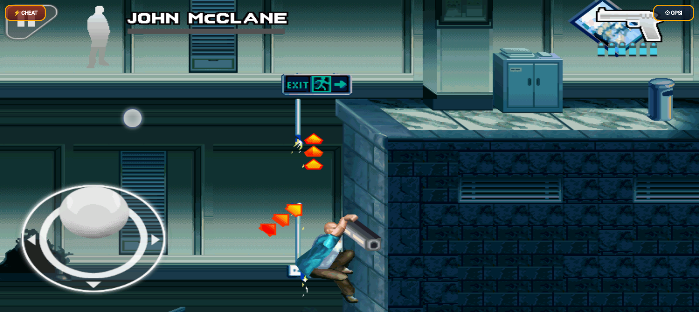
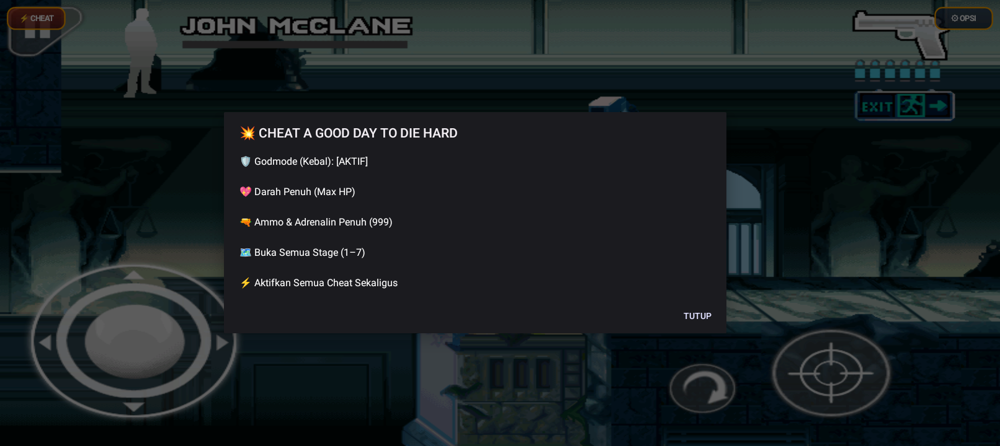

# 💥 A Good Day to Die Hard — Android Port + Built-in Cheat Engine

[](https://github.com/GUPRON98/DieHard-Android)
[](https://github.com/GUPRON98/DieHard-Android)

Port Android dari **A Good Day to Die Hard** (Samsung GT-S8000 `480x800`) dengan tampilan **Fullscreen Landscape**, **Full Touchscreen Controls**, **Built-in Cheat Engine (`⚡ CHEAT`)**, dan **Menu Opsi (`⚙ OPSI`)**.

---

## 📸 Screenshots

| Gameplay Fullscreen | In-Game Cheat Engine |
| :---: | :---: |
|  |  |

---

## ⚡ Fitur Utama

- 📱 **Fullscreen Landscape (`800x480`)**: Mendukung mode layar penuh (*stretch*) maupun aspek rasio asli melalui tombol `⚙ OPSI`, plus pengaturan target FPS dan getar tombol.
- 👆 **Full Touchscreen Support**: Kontrol sentuh native dari versi Samsung GT-S8000 dipetakan penuh ke layar landscape.
- ⚡ **Built-in Cheat Engine (`⚡ CHEAT`)**:
  - 🛡️ **Godmode (Kebal)** `[ON/OFF]`
  - 💖 **Darah Penuh (Max HP)**
  - 🔫 **Ammo & Adrenalin Penuh (999)**
  - 🗺️ **Buka Semua Stage (1–7)**
  - ⚡ **Aktifkan Semua Cheat Sekaligus**

---

## 📦 Download APK

Unduh file APK siap pasang:
- **[DieHard.apk](DieHard.apk)** (`minSdkVersion 21`, `targetSdkVersion 34`, pure Java/Smali tanpa native `.so`)

---

## 🛠️ Build dari Source (Termux / Linux)

```bash
chmod +x build_apk.sh
./build_apk.sh
```
